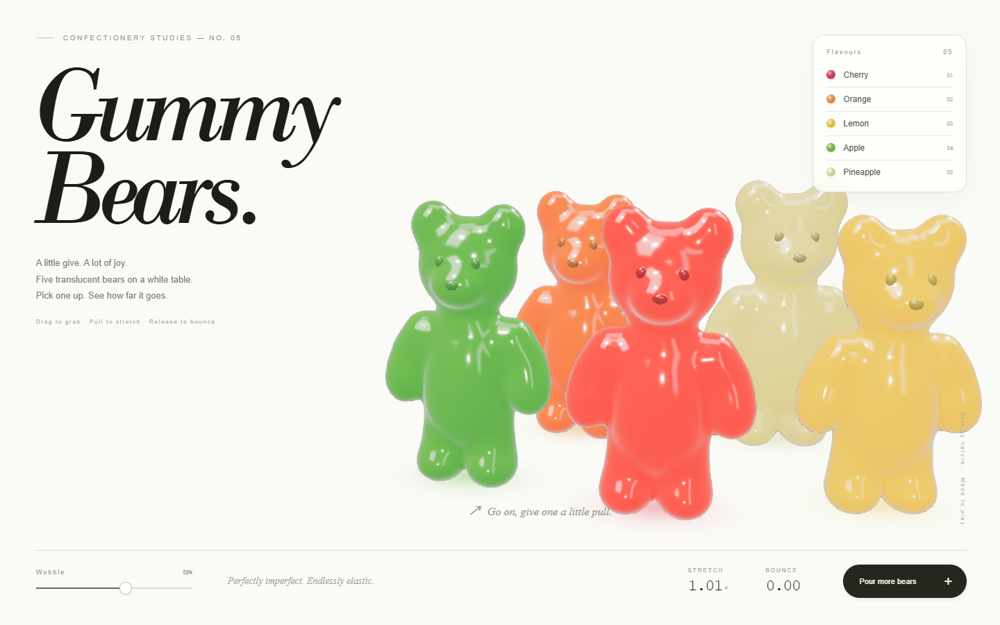

# Gummy Bears

**A little give. A lot of joy.**

一个可以抓住、拉伸、挤压、投掷和倾倒的 3D 软糖熊交互实验。以白色桌面和编辑式排版为舞台，探索半透明糖果材质与富有弹性的软体运动。



## 体验

[**打开在线演示 →**](https://issnoopy001.github.io/gummy-bears/)

下载并用现代浏览器打开 **[index.html](index.html)**，即可开始，无需安装或构建。首次加载需要联网获取 CDN 上的 three.js。

| 操作 | 效果 |
| --- | --- |
| 按住熊的任意部位并拖动 | 抓取、拉伸与倾斜 |
| 抓住站立熊的头部向下推 | 压扁、向两侧膨胀 |
| 松开 | 弹性恢复与阻尼摆动 |
| 快速拖动后松开 | 投掷、落地挤压与弹跳 |
| 调整 Wobble | 改变弹性与摆动程度 |
| 点击 Pour more bears | 从上方倾倒五只新熊 |

支持鼠标和触摸操作。画布聚焦后，空格键可倾倒，Esc 可松开抓取。

## 实现亮点

- **连贯熊形**：以平滑融合的椭球隐式场构建轮廓，使用 marching tetrahedra 提取单一连续表面。
- **轻量软体**：每只熊包含 26 个质量点，通过分区形状匹配、体积修正、距离与角度约束连接。
- **局部拉伸**：GPU 上的四权重变形与局部仿射坐标，让颈部和四肢拉长时变细。
- **糖果材质**：物理透射、折射、按部位及变形厚度调节的颜色吸收、清漆高光与程序化摄影棚反射。
- **柔和接触**：颜色阴影、质量点碰撞、落地回弹及随机小跳。
- **独立单文件**：运行所需的样式、几何生成、纹理和物理均包含在 `index.html`；唯一外部依赖是固定版本的 three.js CDN。

## 性能设计与边界

物理以固定 **120 Hz** 计算，绘制上限为 **60fps**。表面网格约 1.49 万个三角形；法线变换矩阵在 CPU 上按质量点预先计算，避免逐顶点求逆。画布设有像素预算，并在持续低帧率时自动降低渲染分辨率。

同屏最多 15 只熊，继续倾倒会替换最早加入且未被抓住的熊。软体与碰撞属于面向交互的近似模拟，并非精确有限元或连续表面碰撞。实际帧率取决于 GPU、浏览器硬件加速和显示尺寸。

## 本地预览

直接双击 `index.html`，或在项目目录运行任意静态服务器，例如已安装 Node.js 时：

```sh
npx --yes http-server . -p 8080
```

然后打开 `http://localhost:8080`。项目不需要 npm 依赖或编译步骤。

## 技术栈与致谢

HTML · CSS · JavaScript ES Modules · WebGL · [three.js r170](https://github.com/mrdoob/three.js/tree/r170)

three.js 通过 jsDelivr CDN 加载，遵循其 [MIT License](https://github.com/mrdoob/three.js/blob/r170/LICENSE)。预览图来自项目本身，运行时不依赖该图片。

---

A creative coding project by [isSnoopy001](https://github.com/isSnoopy001).
